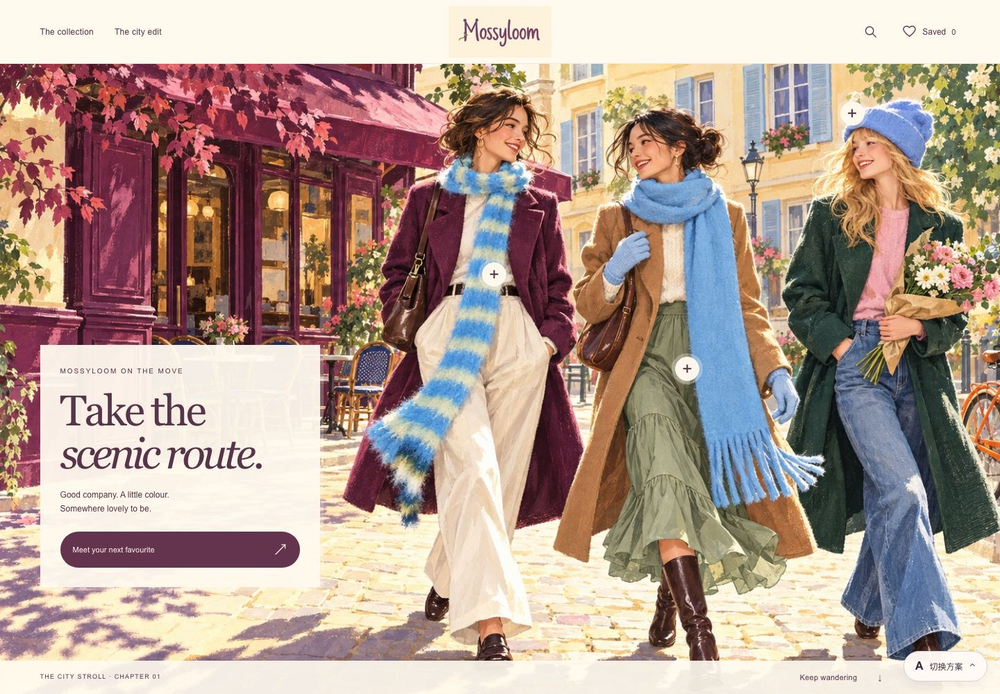

# Mossyloom · Six Little Worlds

Six responsive storefront demos for Mossyloom. Use the Chinese overview page to compare the designs.

**[Open the six-demo overview](https://violetloveai.github.io/mossyloom-six-worlds/)**



| Demo | Direction |
| --- | --- |
| [A · City Stroll](https://violetloveai.github.io/mossyloom-six-worlds/a/) | 城市漫游插画 |
| [B · City in Colour](https://violetloveai.github.io/mossyloom-six-worlds/b/) | 明亮都市大片 |
| [C · Colour Studio](https://violetloveai.github.io/mossyloom-six-worlds/c/) | 色彩配饰商店 |
| [D · Studio Notes](https://violetloveai.github.io/mossyloom-six-worlds/d/) | 女孩的穿搭手帐 |
| [E · A Knitted Daydream](https://violetloveai.github.io/mossyloom-six-worlds/e/) | 针织奇想世界 |
| [F · Sunday at Home](https://violetloveai.github.io/mossyloom-six-worlds/f/) | 周末公寓衣橱 |

## What works

Each demo has category filters, product galleries, search, saved favourites and a menu for switching between designs. The shared catalog contains 30 products across scarves, hats and gloves. Favourites stay in the current browser through local storage.

These are design previews. Prices and availability are provisional. There is no checkout, payment processing or order submission. Campaign scenes are illustrative. Product galleries use the supplied product photographs.

## Run locally

Requires Git and Python 3. No package installation or build step is needed.

1. Clone the repository:

   ```sh
   git clone https://github.com/violetloveAI/mossyloom-six-worlds.git
   ```

2. From the same directory, start the local server:

   ```sh
   python3 -m http.server 8000 --bind 127.0.0.1 --directory .
   ```

3. Open [the local overview](http://127.0.0.1:8000/mossyloom-six-worlds/) in your browser.

The local URL uses the same repository subpath as GitHub Pages.

## Structure and deployment

The site uses static HTML, CSS and vanilla JavaScript. All runtime assets are included. The demos do not call external APIs or require API keys.

- `index.html`: overview and links to all six demos.
- `a/` through `f/`: each design's page and stylesheet.
- `assets/common.js` and `assets/common.css`: shared interactions and UI styles.
- `assets/catalog.js`: product data and gallery image paths.
- `assets/brand/`, `assets/hero/`, `assets/products/` and `assets/previews/`: logo, campaign artwork, product photos and screenshots.

GitHub Pages serves the root of the `main` branch. `.nojekyll` disables Jekyll processing. Relative links support deployment under `/mossyloom-six-worlds/`. This repository is separate from the original Mossyloom website.

## References and assets

The design brief referenced Jess Game Knit, NAADAM, Catherine Tough, Saffy McNamara and Moody MuMu for image-led retail presentation. These demos are not affiliated with those brands and do not include their campaign images.

Brand assets and supplied product photos retain their existing rights. This public preview does not grant permission to reuse them. Generated campaign artwork is included for concept review. No open-source license is granted by this repository.
